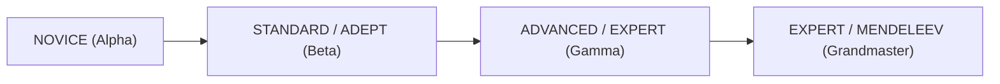
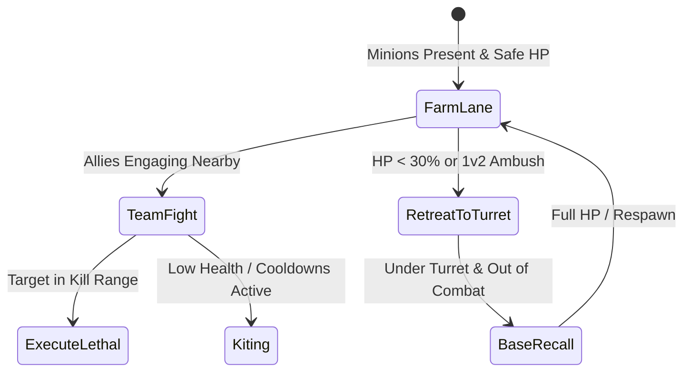

# ELEMENTA — Artificial Intelligence Systems Specification
**Project:** ELEMENTA — Chemistry Trading Card Game & Interactive Learning Platform  
**Document Code:** AI-SYS-v2.0  
**Generated Date:** 2026-10-21  

---

## 1. Overview
ELEMENTA features multi-agent AI systems tailored for two distinct real-time and turn-based environments:
1. **Turn-Based Duelist AI (`duelEngine.ts` & `opponentAi.ts`)** for card duels.
2. **Real-Time Kinematic Bot AI (`mobaBotAi.ts`)** for MOBA combat.

Both systems operate with deterministic rules engines, avoiding random decision-making in high-difficulty tiers.

---

## 2. Card Battle & Duelist AI Architecture

### 2.1. 4-Tier Difficulty Progression

1. **Tier 1: Novice (`NOVICE`):**
   - Focus: Basic card deployment.
   - Behavior: Summons highest ATK monster available. Always attacks directly or targets lowest ATK opponent monster. Does not chain quick-play spells.
2. **Tier 2: Adept / Standard (`ADEPT` / `STANDARD`):**
   - Focus: Resource curve management.
   - Behavior: Considers mana efficiency. Sets face-down traps when mana remains. Targets threat monsters with special effects.
3. **Tier 3: Expert / Advanced (`EXPERT` / `ADVANCED`):**
   - Focus: Predictive combat calculation & counterplay.
   - Behavior:
     - Calculates lethal combat lines before committing attacks.
     - Checks whether attacking triggers known opponent traps (e.g. *Ammonium Smoke*).
     - Holds Quick-Play spells (e.g. *Acid-Base Neutralization*) in hand to negate incoming high-damage attacks.
     - Performs multi-cost strategic draws (LP Draw, Tribute Draw) when hand count drops below 2.
4. **Tier 4: Grandmaster (`MENDELEEV`):**
   - Focus: Industrial archetype combos & equilibrium manipulation.
   - Behavior:
     - Deploys the *Haber-Bosch Hyperbaric Reactor* and *V₂O₅ Contact Process* field spells to optimize environmental parameters.
     - Triggers Compound Synthesis for boss monsters (\(HNO_3, H_2SO_4\)).
     - Chains defensive spells to preserve key synthesis reagents on the board.

---

## 3. Real-Time MOBA Bot AI Architecture

### 3.1. Behavioral State Machine
The MOBA bot AI operates on an evaluation loop running at 10 Hz:

### 3.2. Kinematic Targeting & Predictive Aiming
For skill shots (e.g. Sodium's *Alkali Burst* or Chlorine's *Toxic Orb*), Challenger tier bots estimate the target's future position:
\[
\vec{P}_{\text{future}} = \vec{P}_{\text{current}} + \vec{V}_{\text{target}} \times t_{\text{travel}}
\]
where \(t_{\text{travel}} = \frac{\|\vec{P}_{\text{current}} - \vec{P}_{\text{caster}}\|}{v_{\text{projectile}}}\).

---

## 4. Verification & Testing
All 4 AI difficulty tiers are verified across automated test suites:
- `test-card-battle.mjs` (Section 7)
- `test-duel-engine.mjs` (Section 19)
- `test-moba.mjs` (Section 4)
